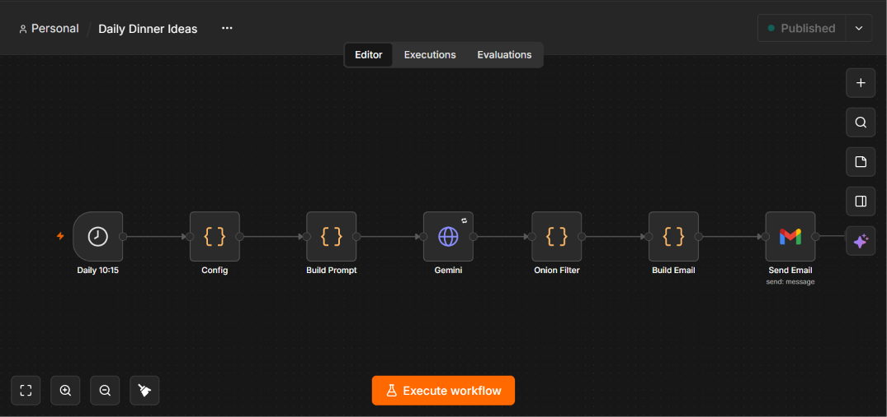
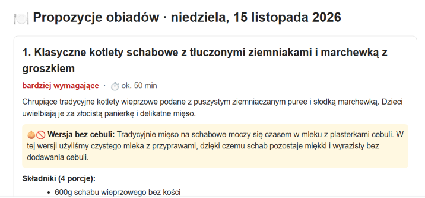

# Daily Dinner Ideas Agent (n8n + Gemini)

A self-hosted n8n agent that emails a set of family dinner ideas every day at 10:15 (Europe/Warsaw). The meals are aimed mainly at children, use ingredients usually already at home, vary in difficulty, and follow one non-negotiable rule: **no onion in any form**.

> **Status:** 🟢 Active since 2026-11-15, running daily at 10:15 (Europe/Warsaw) on `gemini-3.5-flash`. End-to-end test passed (7/7 dishes passed the onion check, email delivered); scheduled runs deliver on their own.

---

## Table of contents

- [What it does](#what-it-does)
- [Screenshots](#screenshots)
- [Example output](#example-output)
- [Requirements (functional spec)](#requirements-functional-spec)
- [Architecture](#architecture)
- [Design decisions](#design-decisions)
- [Repository structure](#repository-structure)
- [Setup](#setup)
- [Configuration](#configuration)
- [Testing](#testing)
- [Privacy and data handling](#privacy-and-data-handling)
- [Known limitations](#known-limitations)
- [Roadmap](#roadmap)
- [Changelog / working log](#changelog--working-log)

---

## What it does

Every day at 10:15 the agent:

1. Builds a prompt with the household's cooking rules and a few randomly chosen "inspirations of the day" (e.g. groats, fish, casseroles).
2. Asks Google Gemini for 7 dinner ideas in a strict JSON format.
3. Runs a deterministic code check that removes any recipe mentioning onion or its relatives.
4. Builds an HTML email with one card per dish (difficulty, time, short description, ingredients, steps, and a highlighted note when the dish is an onion-free version of a traditionally onion-based recipe).
5. Sends the email via Gmail.

> **Language note:** the code (node names, variables, JSON fields, comments) is in English. The prompt sent to the model and the email are in **Polish on purpose**, because the people using the agent are a Polish family. See [D9](#d9-code-in-english-user-facing-content-in-polish).

## Screenshots

**The workflow in n8n** (7 nodes, one linear flow):



**The daily email** (Polish by design, see the example below for a translation). The yellow box marks an onion-free version of a dish that is traditionally made with onion:



## Example output

One of the seven dishes from the first real run (2026-11-15), translated from Polish:

> **2. Turkey meatballs in a creamy tomato sauce with rice**
> *easy · ⏱️ approx. 30 min*
> Juicy, soft turkey meatballs in a mild tomato-cream sauce. Light, tasty and very popular with kids.
>
> 🧅🚫 **Onion-free version:** traditional meatballs in tomato sauce often include fried onion; here a little garlic and marjoram provide the flavour.
>
> **Ingredients (4 servings):** 500 g minced turkey · 200 g white rice · 500 g tomato passata · 1 egg · 3 tbsp breadcrumbs · 100 ml cream 30% · 1 garlic clove · 1 tsp marjoram · 1 tbsp butter · salt
>
> **Steps:** cook the rice → mix the meat with egg, breadcrumbs, garlic, marjoram and salt → form small meatballs and drop them into simmering passata with butter → cook covered ~15 min → stir in the cream and season → serve on rice.

The full first run: 4 easy, 2 medium, 1 demanding dish; 4 of them marked as onion-free versions of traditional recipes; leek used where allowed.

## Requirements (functional spec)

| # | Requirement | How it is met |
|---|---|---|
| R1 | **No onion in any form**: raw, fried, roasted, as a frying base, powdered. Also excluded: chives, shallots, spring onion | Prompt rule **and** deterministic keyword filter in the `Onion Filter` node |
| R2 | Leek as a vegetable **is allowed**; trace amounts in ready products (ketchup, spice mixes) are ignored | Prompt rule; filter patterns deliberately do not include leek |
| R3 | Dishes that traditionally contain onion may be proposed **only in an onion-free version, clearly marked** | Dedicated JSON field `onion_free_note`, rendered as a highlighted box in the email |
| R4 | Meals for the whole family, cooked mainly for children: mild, tasty, appealing | Prompt rule (no spicy seasoning, kid appeal explained in `description`) |
| R5 | At least 5 ideas per day | Model is asked for 7; email shows a warning if fewer than 5 pass the check |
| R6 | Mixed difficulty: quick/easy dishes and some more demanding ones | Prompt rule (≥2 easy, ≥1 demanding) + `difficulty` enum in the schema |
| R7 | Ingredients from typical home supplies, no special shopping | Prompt rule |
| R8 | Variety between days; occasional repeats are acceptable | Random "inspirations of the day"; no history stored (by design, for now) |
| R9 | Daily, including weekends, at 10:15 | Schedule Trigger with cron `15 10 * * *`, workflow timezone `Europe/Warsaw` |

## Architecture

```
┌─────────────┐   ┌────────┐   ┌──────────────┐   ┌────────┐
│ Daily 10:15 │──▶│ Config │──▶│ Build Prompt │──▶│ Gemini │
│ (Schedule)  │   │ (Code) │   │ (Code)       │   │ (HTTP) │
└─────────────┘   └────────┘   └──────────────┘   └───┬────┘
                                                      │
┌────────────┐   ┌─────────────┐   ┌──────────────┐   │
│ Send Email │◀──│ Build Email │◀──│ Onion Filter │◀──┘
│ (Gmail)    │   │ (Code)      │   │ (Code)       │
└────────────┘   └─────────────┘   └──────────────┘
```

| Node | Type | Role |
|---|---|---|
| `Daily 10:15` | Schedule Trigger | Cron `15 10 * * *`; timezone from workflow settings (`Europe/Warsaw`) |
| `Config` | Code | Single place for all settings (recipient, model, counts, servings, forbidden patterns) |
| `Build Prompt` | Code | Builds the system instruction, user prompt, random inspirations and the Gemini `responseSchema` |
| `Gemini` | HTTP Request | `POST .../v1beta/models/{model}:generateContent`, predefined n8n credential *Google Gemini(PaLM) Api*, retry 3× every 5 s, 120 s timeout |
| `Onion Filter` | Code | Parses the JSON answer (skipping "thought" parts), removes dishes containing forbidden words, reports parse errors instead of crashing |
| `Build Email` | Code | Maps difficulty codes to Polish labels, renders HTML-escaped cards, subject line with the Polish date, warnings |
| `Send Email` | Gmail | Sends the HTML email using the shared Gmail OAuth2 credential |

### Output schema (requested from Gemini)

```json
{
  "meals": [
    {
      "name": "string",
      "description": "string (what it is + why kids will like it)",
      "difficulty": "easy | medium | demanding",
      "time_minutes": 0,
      "ingredients": ["string"],
      "steps": ["string"],
      "onion_free_note": "string (empty unless it is an onion-free version of an onion dish)"
    }
  ]
}
```

Field values (`name`, `ingredients`, …) are written by the model in Polish; `difficulty` is a language-neutral code mapped to a Polish label in `Build Email`.

## Design decisions

### D1. n8n self-hosted
Chosen up front. The agent joins an existing portfolio of n8n agents on the same VPS and reuses existing credentials (Gmail OAuth2) and conventions.

### D2. Model: Gemini free tier (API key from Google AI Studio)
Options considered:

| Option | Why not (for now) |
|---|---|
| Claude Haiku via Anthropic API | Credential already exists and is cheap, but pay-as-you-go |
| Claude Sonnet via Anthropic API | Better recipes, several times more expensive |
| A model via OpenRouter | Extra credential, pay-as-you-go |
| Gemini via Google AI Pro subscription credits | The consumer subscription does **not** include an API key; its monthly Google Cloud credits require a Cloud billing account. Kept as an upgrade path |
| **Gemini free-tier API key** ✅ | Zero cost, no billing account, limits far above 1 request/day |

Current model: `gemini-3.5-flash` (configurable in one place). How we got there:

| Model | Result |
|---|---|
| `gemini-2.5-flash` | 404: no longer offered to new API users |
| `gemini-3.8-flash` | Connection aborted after ~2.5 min, beyond the 120 s timeout (most likely long "thinking" + 7 full recipes) |
| `gemini-3.5-flash` | ✅ Works, fast enough, good quality |

Switching providers later means changing only the `Gemini` node and its credential.

### D3. Determinism over prompt compliance
The onion rule is enforced in code, not only in the prompt. The filter checks:

- **Strictly** (`ingredients`, `steps`): any match on `cebul|szczypior|szalot|dymk|onion|shallot|chive` (Polish and English stems) rejects the dish.
- **Leniently** (`name`, `description`): the Polish phrase "bez cebuli" ("without onion") is stripped first, so a dish called "Goulash without onion" is allowed.
- `onion_free_note` is never checked, because it is the place where onion is supposed to be mentioned.

### D4. Reject instead of warn
When the model still puts onion into a recipe, the dish is dropped rather than shown with a "skip the onion" warning. A recipe the model has adapted itself is coherent; a recipe with "just skip the onion" can be incomplete (e.g. "sauté the onion, then add the meat"). To keep ≥5 ideas, the model is asked for 7.

### D5. Variety without state
No history file for now (occasional repeats are acceptable). Instead, the prompt includes 4 random "inspirations of the day" from a list of ~22 categories, plus the current date and `temperature: 1.0`.

### D6. Structured output
`responseMimeType: application/json` + `responseSchema` (with an enum for difficulty) makes parsing reliable and keeps the email layout stable.

### D7. Fail visible, not silent
If the model's answer cannot be parsed, the workflow still sends an email with a clear warning instead of failing silently. If fewer than 5 dishes pass the check, the email says so.

### D8. Timezone set explicitly
`Europe/Warsaw` is set in the workflow settings, never left as the server default, so 10:15 stays 10:15 across DST changes.

### D9. Code in English, user-facing content in Polish
Node names, variables, JSON fields and comments are in English so the workflow is readable for anyone reviewing it. The model prompt and the email stay in Polish because the target users are a Polish family. Difficulty is stored as a neutral code (`easy | medium | demanding`) and translated only at render time, which keeps logic and presentation separate. The repository file matches the workflow that actually runs in production.

## Repository structure

```
.
├── README.md                          # this document
├── daily-dinner-ideas.workflow.json   # n8n workflow export (no secrets, recipient is a placeholder)
└── docs/
    ├── workflow.png                   # screenshot of the n8n canvas
    └── email-example.png              # screenshot of a daily email (no addresses visible)
```

## Setup

### Prerequisites
- Self-hosted n8n (tested target: Docker on a VPS)
- A Gmail OAuth2 credential in n8n
- A Google account with access to Google AI Studio

### Steps
1. **Get a Gemini API key** at <https://aistudio.google.com/apikey>. Never commit it or paste it into chats.
2. **Create a credential in n8n:** *Credentials → New → Google Gemini(PaLM) Api*
   - Host: leave the default (`https://generativelanguage.googleapis.com`)
   - API Key: your API key
   - n8n tests the key on save. Fallback if needed: a *Header Auth* credential with header `x-goog-api-key`
3. **Import the workflow:** *Workflows → Import from File →* `daily-dinner-ideas.workflow.json`.
4. **Assign credentials:** open the `Gemini` node and select your Google Gemini(PaLM) Api credential; open `Send Email` and select your Gmail OAuth2 credential.
5. **Configure:** open `Config` and set at least `recipient`.
6. **Check the timezone:** *Workflow settings → Timezone = Europe/Warsaw*.
7. **Test node by node** (see [Testing](#testing)), then publish/activate the workflow.

## Configuration

All settings live in the `Config` node:

| Key | Default | Meaning |
|---|---|---|
| `recipient` | `YOUR_EMAIL@example.com` | Recipient email address |
| `model` | `gemini-3.5-flash` | Gemini model name |
| `requestedCount` | `7` | How many dishes to request |
| `minimumCount` | `5` | Below this, the email shows a warning |
| `servings` | `4` | Servings used for ingredient amounts |
| `forbiddenPatterns` | `cebul, szczypior, szalot, dymk, onion, shallot, chive` | Regex fragments for the onion filter (case-insensitive) |

## Testing

- **Local, mock data:** all Code nodes executed in Node.js with a fake Gemini response:
  - an onion-free version of a traditional onion dish ("… bez cebuli" with a note) → **accepted**
  - a dish with "cebula 1 szt" ("1 onion") in ingredients → **rejected**
  - a "thought" part from a thinking model → **ignored** by the parser
  - HTML injection in a dish name → **escaped**
  - empty/invalid model response → **warning email instead of crash**
  - all node connections reference existing node names
- **In n8n:** node-by-node run (`Gemini` → `Onion Filter`), then a full manual run with email delivery, then activation.
  - First real output: 7/7 dishes accepted, 0 rejected; 4 dishes correctly marked as onion-free versions; leek used as allowed; difficulty mix 4 easy / 2 medium / 1 demanding.
  - First scheduled run (2026-11-15, 10:15) delivered on its own.

## Privacy and data handling

- The prompt contains only cooking rules: no names, ages or other personal data.
- Gemini API terms: in the EEA, Switzerland and the UK, the paid-services data terms apply to all services, including the free quota, so prompts and responses are not used to improve Google's products.
- The API key is stored only as an n8n credential; the exported workflow JSON contains no secrets.
- The recipient address is a placeholder in this repository.

## Known limitations

- Keyword filtering cannot catch every possible phrasing (e.g. an unusual dialect word). The prompt rule is the first line of defence, the filter the second.
- No retry loop when too few dishes pass the check: the email is still sent, with a warning.
- No memory of previous days, so repeats are possible.
- Free-tier limits and available model names change quickly; the model is configurable in one place.

## Roadmap

- [x] Generate Gemini API key and create the n8n credential
- [x] First end-to-end run and activation
- [x] Refactor code to English (node names, variables, JSON fields)
- [x] Add screenshots: workflow canvas and an example email
- [ ] Observe a few days of output; if one protein dominates (first run: 4/7 poultry), add a rule like "max 2 dishes with the same type of meat"
- [ ] Error workflow / alert if the run fails entirely
- [ ] Retry with feedback when fewer than 5 dishes pass the check
- [ ] Optional history (`/home/node/.n8n-files/`) to reduce repeats
- [ ] Optional weekly "portfolio" email with a larger set of ideas
- [ ] Optional Telegram delivery
- [ ] Evaluate model quality (Gemini Flash vs. alternatives)
- [ ] *Idea, parked (nice to have):* Cookidoo as inspiration. The Home Assistant Cookidoo integration cannot search the recipe catalogue; it only reads the meal-plan calendar and shopping lists, and writes only to "Additional purchases". Cheapest option: add a Cookidoo search link next to each suggested dish. Unofficial Cookidoo tools that use account credentials are not planned

## Changelog / working log

### 2026-10-24
- Requirements gathered one question at a time: onion rule (incl. what is and is not excluded), family/kids focus, ≥5 ideas, mixed difficulty, home ingredients, no repeat tracking, daily 10:15 incl. weekends.
- Confirmed the existing n8n instance is running.
- Model decision: Gemini free-tier API key. Researched that the Google AI Pro subscription does not provide an API key directly (only Cloud credits via a billing account).
- Corrected an earlier assumption: for EEA users, free-tier Gemini API data is handled under the paid-services terms (not used for training).
- Built the 7-node workflow and tested the Code nodes locally with mock data.
- Decided to reject (not just flag) dishes where onion still appears in the recipe.

### 2026-11-14
- Switched the Gemini node to n8n's native *Google Gemini(PaLM) Api* credential (key is tested on save, reusable by native Gemini/AI nodes).
- First runs in n8n: imported workflow, assigned credentials, set recipient and timezone. Model changes: 2.5 Flash (404, retired for new users) → 3.8 Flash (timeout) → 3.5 Flash (works).
- Node-by-node test passed, full run sent the email, workflow published (active).
- Researched connecting Cookidoo via Home Assistant to n8n. It works technically, but the integration offers no recipe search, so the agent could not draw inspiration from the Cookidoo catalogue. Parked as a nice-to-have (see Roadmap).

### 2026-11-15
- 10:15: first scheduled run delivered the email on its own.
- Created the public GitHub repository.
- Before publishing, refactored the code to English (D9): node names, variables, JSON schema fields and comments; difficulty stored as `easy | medium | demanding` and mapped to Polish labels at render time. Prompt and email stay in Polish. Re-tested locally with mock data, then replaced the production workflow in n8n with the refactored version so the repository matches what runs.
- Added a translated example output and a repository structure section to the README.
- Added GitHub topics (`n8n`, `gemini`, `llm`, `ai-agent`, `automation`, `workflow-automation`, `prompt-engineering`) and screenshots of the workflow and an example email (`docs/`).
